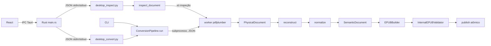

# Prometeu — guia de arquitetura e manutenção

Guia para o Vitor começar a manter e evoluir o Prometeu. Ele explica **como o
projeto pensa**, **onde cada coisa mora** e **como mudar algo sem quebrar as
garantias** que o projeto oferece. Os outros documentos em `docs/` continuam
valendo; este é a porta de entrada.

Ordem de leitura sugerida (cerca de 1 hora):

1. Seções 1 a 4 deste guia (visão geral e o caminho de uma conversão).
2. `src/prometeu/application/pipeline.py`, que é o roteiro do sistema inteiro.
3. `src/prometeu/document/model.py` e `document/contracts.py` (os tipos).
4. Seção 7 (regras que não se quebram) antes da primeira mudança.

---

## 1. O que o Prometeu é

Um conversor **local** de PDF textual para **EPUB 3 reflowable** (o texto se
reorganiza conforme a tela do leitor). Não há conta, servidor, telemetria nem
download durante a conversão. Há duas portas de entrada:

- **CLI** (`prometeu convert entrada.pdf`), em Python puro.
- **Desktop alpha** (`apps/desktop`): interface React dentro de um shell Tauri
  (Rust), que chama o mesmo núcleo Python.

O que ele **não** faz, de propósito, nesta versão: OCR, PDFs digitalizados,
multicoluna, imagens/capa, notas de rodapé, IA. Um PDF fora desse perfil é
**recusado com código de erro**, nunca convertido pela metade. Essa é a filosofia
central: *conservador* — é melhor recusar do que perder conteúdo em silêncio.

## 2. Mapa do repositório

```text
prometeu/
├── src/prometeu/                 núcleo Python (o produto de verdade)
│   ├── cli/__init__.py           argumentos e impressão; nenhuma regra de negócio
│   ├── application/              orquestração e fronteiras com o mundo externo
│   │   ├── pipeline.py           ConversionPipeline.run: o roteiro completo
│   │   ├── safety.py             filesystem seguro, snapshot, prazo, publicação atômica
│   │   ├── metadata.py           título/autor/idioma/identificador finais
│   │   ├── inspection.py         inspeção rápida (sem extrair o texto todo)
│   │   ├── desktop_inspect.py    bridge JSON stdin/stdout usado pelo Rust (inspeção)
│   │   └── desktop_convert.py    bridge JSON stdin/stdout usado pelo Rust (conversão)
│   ├── document/
│   │   ├── model.py              tipos imutáveis: modelo físico e modelo semântico
│   │   └── contracts.py          request, limites, resultados, erros, Protocols
│   ├── extraction/
│   │   ├── pdfplumber_adapter.py supervisor + worker isolado que lê o PDF
│   │   └── _worker.py            ponto de entrada do subprocesso
│   ├── structure/reconstruct.py  físico → semântico (parágrafos, headings, capítulos)
│   ├── cleaning/normalize.py     limpeza (margens, paginação, hífen, espaços, NFC)
│   ├── epub/builder.py           semântico → arquivo EPUB 3
│   └── validation/internal.py    reabre o EPUB e confere o perfil gerado
├── tests/
│   ├── unit/                     testes por módulo
│   ├── integration/              pipeline real, bridges desktop
│   ├── support/pdf.py            gerador de PDF sintético (write_pdf, TextLine)
│   └── fixtures/                 sample.pdf + generate.py (regenera a fixture)
├── apps/desktop/
│   ├── src/                      React: App.tsx (tela), desktop.ts (chamadas IPC)
│   └── src-tauri/                Rust: main.rs (comandos, subprocesso Python)
├── docs/                         contratos, segurança, gates, handoffs, este guia
├── pyproject.toml                pacote, ferramentas (ruff, mypy strict, pytest)
├── requirements*.lock            dependências travadas por hash (usadas no CI)
└── .github/workflows/ci.yml      matriz Python + job desktop
```

A única dependência de runtime do núcleo é `pdfplumber` (que traz `pdfminer.six`).
Todo o resto é biblioteca padrão.

## 3. Arquitetura em uma figura



Três ideias sustentam o desenho:

1. **Dois modelos separados.** O `PhysicalDocument` é a evidência crua do PDF
   (caracteres, posições, fontes) e **nunca é alterado**. O `SemanticDocument` é a
   interpretação (parágrafos, títulos, capítulos). Toda decisão semântica guarda a
   origem física (`SourceReference`), então dá para explicar e testar cada decisão
   sem reabrir o PDF.
2. **O PDF é hostil.** Ele é tratado como entrada de atacante: é lido num
   subprocesso separado, com limites de tempo, CPU, memória e tamanho, e o
   processo principal nunca importa `pdfplumber`.
3. **Nada é publicado sem validação.** O EPUB é escrito num diretório temporário,
   reaberto e validado, e só então aparece no destino, de forma atômica.

As dependências entre módulos apontam numa direção só: `document` não importa
nenhum outro módulo do projeto; `extraction`, `structure`, `cleaning`, `epub` e
`validation` importam `document` (e `structure`/`epub` reutilizam funções de
`cleaning`); `application` junta tudo; `cli` só fala com `application` e com os
contratos. Nenhum módulo de domínio importa CLI, adapter ou builder.

## 4. O caminho de uma conversão

Tudo acontece em `ConversionPipeline.run` (`application/pipeline.py`). Vale ler o
arquivo com esta lista ao lado:

| # | Etapa | Onde | O que garante |
|---|---|---|---|
| 1 | Montar o pedido | `cli/__init__.py` → `ConversionRequest` | CLI só traduz argumentos |
| 2 | Abrir a entrada | `safety.open_input` | arquivo regular, tamanho ≤ limite, começa com `%PDF-` |
| 3 | Fixar o destino | `safety.output_directory`, `check_destination` | saída ≠ entrada, sem symlink, sem sobrescrever sem `--force` |
| 4 | Prazo global | `safety.deadline` (SIGALRM) + `remaining` | 120 s para tudo, até antes da publicação |
| 5 | Snapshot | `safety.snapshot` | cópia privada + SHA-256; falha se o arquivo mudar durante a leitura |
| 6 | Inspeção | `PdfPlumberExtractor.inspect` | classifica páginas em texto / só visual / em branco |
| 7 | Recusas | `pipeline.py` | digitalizado, misto ou vazio → `UnsupportedDocumentError` |
| 8 | Extração | `PdfPlumberExtractor.extract` | linhas e spans com posição e estilo; confere com a inspeção |
| 9 | Metadados | `metadata.resolve_metadata` | override da CLI → metadado do PDF → inferência → genérico |
| 10 | Reconstrução | `structure.reconstruct` | parágrafos, H1/H2/H3, capítulos |
| 11 | Limpeza | `cleaning.normalize` | remove margens repetidas e paginação, desfaz hífen, NFC |
| 12 | Exportação | `EPUBBuilder.export` | EPUB 3 num arquivo temporário, com limite de bytes |
| 13 | Validação | `InternalEPUBValidator.validate` | reabre o ZIP e confere o perfil exato gerado |
| 14 | Publicação | `safety.publish` | `fsync`, diretório não trocado, `os.link` (ou `os.replace` com `--force`) |

Qualquer etapa que falha levanta uma subclasse de `PrometeuError`. O `run` captura,
transforma em `Diagnostic` com severidade `ERROR` e devolve `ConversionResult`
com `success=False` e o código de saída. **Exceções nunca escapam do pipeline.**

### O worker de extração

`extraction/pdfplumber_adapter.py` tem duas metades no mesmo arquivo:

- **Supervisor** (`PdfPlumberExtractor`, `_run`, `_supervise`): roda no processo
  principal. Abre o arquivo, inicia `python -m prometeu.extraction._worker`
  passando o descritor (`pass_fds`), manda um JSON pelo stdin e lê a resposta pelo
  stdout. A cada 20 ms confere tempo e memória (RSS via `/proc` no Linux, via
  `libproc` no macOS). Mata o worker se passar do limite.
- **Worker** (`_worker_main`, `_worker_inspect`, `_worker_extract`): roda no
  subprocesso. Aplica `RLIMIT_CPU` (e `RLIMIT_AS` no Linux), abre o PDF com
  pdfplumber, agrupa caracteres em linhas (`_physical_lines`) e devolve só
  dicionários simples. Erros viram `{"ok": false, "error": {...}}` com uma
  categoria (`input`, `unsupported`, `extraction`) que o supervisor converte na
  exceção certa (`_raise_worker_error`).

Regra prática: **funções que começam com `_worker` ou são chamadas por elas rodam
no subprocesso** e só podem falhar via `_fail(...)`.

## 5. Os dois modelos

Todos os tipos ficam em `document/model.py`, são `@dataclass(frozen=True,
slots=True)` e validam suas invariantes em `__post_init__`.

**Físico** (o que o PDF diz):

| Tipo | Conteúdo | ID |
|---|---|---|
| `PhysicalDocument` | páginas consecutivas desde 1, metadados do PDF | `pdf-<sha256>` |
| `PhysicalPage` | largura, altura, linhas | número da página |
| `PhysicalLine` | bbox + spans; `.text` é derivado | `p{página}-l{linha}` |
| `PhysicalSpan` | texto contínuo com o mesmo estilo | `p{página}-l{linha}-s{span}` |
| `TextStyle` | fonte, tamanho, negrito, itálico | — |

Coordenadas em pontos (1/72 pol.), origem no canto **superior** esquerdo, `y`
crescendo para baixo.

**Semântico** (o que o Prometeu entendeu):

| Tipo | Conteúdo |
|---|---|
| `SemanticDocument` | `Metadata` + capítulos |
| `Chapter` | `heading` (H1 opcional) + `blocks` em ordem de leitura |
| `Heading` | nível 2 ou 3 dentro de `blocks`; nível 1 só em `Chapter.heading` |
| `Paragraph` | sequência de `Inline` |
| `Inline` | texto + negrito/itálico + `SourceReference` |

IDs semânticos derivam da origem física (`para-p1-l2`, `heading-p2-l1`,
`chapter-p2-l1`), então são estáveis entre execuções.

## 6. As heurísticas (onde mexer para melhorar a qualidade)

Quase toda melhoria de qualidade de conversão é ajuste de uma destas regras. Os
números abaixo estão no código; mude um de cada vez e sempre com teste.

| Decisão | Regra atual | Onde |
|---|---|---|
| Caracteres na mesma linha | sobreposição vertical ≥ 50% da menor altura, ou baselines a ≤ 2 pt | `_same_line` |
| Negrito / itálico | nome da fonte contém `bold`, `black`, `heavy`, `semibold` / `italic`, `oblique` | `_style` |
| Novo parágrafo (mesma página) | espaço vertical > 0,8 × altura da linha, recuo diferente > 0,8 × altura, linha acima da anterior ou mudança de estilo | `ParagraphReconstructor.reconstruct` |
| Parágrafo continua na página seguinte | anterior termina nos 20% finais, próxima começa nos 20% iniciais, sem pontuação final, começa com minúscula, mesmo recuo (≤ 12 pt) e estilo | idem |
| Tamanho do corpo | `median_low` dos tamanhos de spans não negritos | `body_font_size` |
| Heading | parágrafo de uma linha, todo em negrito, fonte > 1,05 × corpo; tamanhos distintos viram níveis; o maior só é H1 se > 1,3 × corpo | `_heading_levels` |
| Margem | cabeçalho: base da linha nos 10% superiores; rodapé: topo nos 10% inferiores | `_margin` |
| Texto marginal repetido | mesmo texto, mesma margem, em mais de uma página | `repeated_marginal_origins` |
| Paginação | `12`, `- 12 -`, `[12]`, `página 12`, numa margem, formando sequência coerente com o número da página em ≥ 2 páginas; número grande e negrito no topo é preservado (pode ser título) | `pagination_origins` |
| Deshifenização | linha termina em `-` ASCII, a seguinte começa com minúscula, a palavra unida aparece em outro ponto do documento e a forma com hífen não aparece | `normalize` |
| Título inferido | primeira linha não vazia da página 1, 4–160 caracteres, sem pontuação final, nos 30% superiores, fonte > 1,3 × mediana das demais linhas da página | `resolve_metadata` |

Cada `ponytail:` no código marca uma simplificação consciente com limite conhecido
e o caminho de evolução (`grep -rn "ponytail:" src apps`).

## 7. Regras que não se quebram

Estas garantias são o motivo de o código parecer "cuidadoso demais" em alguns
pontos. Antes de simplificar algo em `safety.py`, no adapter ou nos bridges,
confira se não está removendo uma delas (detalhes em `SECURITY.md`):

1. O PDF só é lido no worker supervisionado, com limites finitos. Nunca importe
   `pdfplumber` fora das funções do worker.
2. A entrada nunca é sobrescrita (nem por hardlink ou symlink). Saída existente
   falha, a não ser com `--force`.
3. Nada aparece no destino antes de passar no validador interno.
4. Sem rede, sem telemetria, sem cache de documentos.
5. Diagnósticos mostram etapas, contagens e códigos, nunca o texto do documento;
   a CLI escapa caracteres de controle de terminal nas mensagens.
6. Caractere incompatível com XML 1.0 **falha** com código; não é removido em
   silêncio.
7. Validação que não rodou é `NOT_RUN`, nunca `PASSED`.
8. No desktop, o JavaScript nunca informa caminhos nem executáveis. Os caminhos
   vêm de diálogos nativos e ficam guardados no Rust.

## 8. Desktop

```text
App.tsx ──invoke──▶ main.rs ──spawn python -I -m ...──▶ desktop_*.py ──▶ núcleo
   ▲                   │  (grupo de processo próprio,          │
   └──── Channel ◀─────┘   timeout 130 s, JSON ≤ 32/64 KiB)    ▼
                                                        stdout JSON
```

- **React** (`apps/desktop/src/App.tsx`): uma máquina de estados (`State`) com as
  fases `library → selecting → inspecting → ready → choosing-output → converting
  → success`, mais `inspection-error` e `conversion-error`. `desktop.ts` é a
  única camada que fala com o Tauri; os testes de `App.test.tsx` simulam esse
  módulo.
- **Rust** (`src-tauri/src/main.rs`): três comandos — `select_and_inspect_pdf`,
  `convert_selected_pdf`, `reveal_epub`. `AppState` permite uma operação por vez
  e guarda o PDF escolhido e o último EPUB. `run_bridge` inicia o Python num grupo
  de processos próprio, para que fechar a janela ou estourar o prazo mate o
  Python **e** o worker, sem atingir outros processos.
- **Python** (`desktop_inspect.py`, `desktop_convert.py`): leem um JSON pequeno do
  stdin, revalidam tudo e respondem `{"ok": true, ...}` ou `{"ok": false,
  "error": {...}}`. O Rust só aceita respostas coerentes com o exit code (`accept`).
- **Permissões Tauri**: `capabilities/main.json` lista os comandos que a janela
  pode chamar; cada comando tem um `.toml` em `permissions/` (o de
  `select_and_inspect_pdf` é gerado pelo `build.rs`, os outros são escritos à mão).
- **Limitação principal**: só funciona em build de desenvolvimento, com a
  variável `PROMETEU_PYTHON` apontando para um Python que tenha este checkout
  instalado. Build release recusa até existir um *sidecar* Python empacotado.

## 9. Erros, diagnósticos e códigos de saída

| Exit | Exceção | Exemplos de código |
|---:|---|---|
| 0 | — | sucesso |
| 1 | `PrometeuError` genérico / falha não classificada | `CONVERSION_FAILED` |
| 2 | `InputError` (e `OSError` de filesystem) | `INPUT_NOT_PDF`, `OUTPUT_EXISTS`, `LANGUAGE_INVALID` |
| 3 | `UnsupportedDocumentError` | `PDF_VISUAL_ONLY_CONTENT`, `PDF_EMPTY`, `PDF_ENCRYPTED` |
| 4 | `ExtractionError` | `TIME_LIMIT`, `PDF_EXTRACTION_TIMEOUT`, `PDF_MALFORMED` |
| 5 | `ExportError` | `EPUB_OUTPUT_LIMIT`, `XML_CHARACTER` |
| 6 | `ValidationError` | `EPUB_VALIDATION_FAILED` |

Códigos de diagnóstico são **estáveis** (testes e a UI dependem deles). Para um
erro novo: escolha a exceção pela categoria, crie um código em `MAIÚSCULAS`, uma
mensagem em português que não exponha conteúdo do documento, e um teste que
afirme o código.

## 10. Testes

```sh
python -m pytest                      # 130 testes, ~15 s
python -m pytest tests/unit -k margin # só testes com "margin" no nome
```

- **Nenhum PDF real** entra no repositório. Os testes geram PDFs na hora com
  `tests/support/pdf.py`:

  ```python
  from tests.support.pdf import TextLine, write_pdf

  pdf = write_pdf(
      tmp_path / "caso.pdf",
      [[TextLine("Capítulo 1", 72, 770, 20, bold=True), TextLine("Texto.", 72, 730)]],
  )
  ```

  Aqui `y` usa a convenção do PDF (origem **embaixo**); o modelo físico inverte
  para origem em cima.
- Para testar só a reconstrução ou a limpeza, monte um `PhysicalDocument` à mão
  (veja `tests/unit/test_reconstruction_metadata.py`) — é rápido e não precisa
  de PDF.
- `tests/integration/test_conversion.py` usa `RecordingExtractor`/`Exporter` para
  inspecionar os modelos intermediários de uma conversão real.
- `sample.pdf` é regenerável com `python -m tests.fixtures.generate`.
- Frontend: `npm test` (Vitest + Testing Library). Rust: `cargo test`; com
  `PROMETEU_PYTHON` configurado, `cargo test -- --include-ignored` roda também a
  inspeção e a conversão reais.

Regra do projeto (`CONTRIBUTING.md`): **toda mudança de comportamento exige
teste**, e um bug é reproduzido em teste antes de ser corrigido.

## 11. Ambiente e comandos

```sh
# núcleo (Python 3.11+; o CI cobre 3.11–3.13)
python3 -m venv .venv
. .venv/bin/activate
python -m pip install --require-hashes -r requirements-dev.lock
python -m pip install --no-deps -e '.[dev]'

# checagens que o CI exige
python -m ruff check .
python -m ruff format --check .
python -m mypy src/prometeu
python -m pytest
python -m build

# usar
prometeu convert tests/fixtures/sample.pdf -o /tmp/amostra.epub --language pt-BR

# desktop (precisa de Node ≥ 22.12 e Rust)
cd apps/desktop
npm ci
npm run lint && npm run typecheck && npm test && npm run build
export PROMETEU_PYTHON="$(cd ../.. && pwd)/.venv/bin/python"
npm run tauri -- dev
```

Se `cargo` não estiver no PATH: `. "$HOME/.cargo/env"`.

## 12. Receitas de manutenção

### Ajustar uma heurística

1. Escreva um teste com o caso que hoje sai errado (PDF sintético ou
   `PhysicalDocument` à mão) e veja-o falhar.
2. Mude **uma** regra da tabela da seção 6.
3. Rode a suíte inteira: as heurísticas interagem. Por exemplo, a mesma função de
   margem é usada pela reconstrução (para isolar a linha) e pela limpeza (para
   removê-la).
4. Converta `sample.pdf` e um PDF sintético mais rico e compare o EPUB antes e
   depois (`unzip -p arquivo.epub EPUB/chapter-0001.xhtml`).

### Mudar algo no EPUB gerado

O validador interno aceita **somente** o perfil que o builder gera. Então toda
mudança em `epub/builder.py` exige a mudança equivalente em
`validation/internal.py` (tags, atributos, metadados permitidos, e o CSS em
`_CSS_TEXT` ↔ `_EXPECTED_CSS`). As constantes são duplicadas de propósito: o
validador é uma checagem independente, não uma cópia do builder.

### Adicionar um metadado novo (ex.: editora)

A cadeia inteira precisa mudar junto:

1. `document/model.py` (`Metadata`) e `contracts.py` (`ConversionRequest`).
2. `application/metadata.py` (resolução e validação).
3. `epub/builder.py` (`_package`) e `validation/internal.py` (lista
   `allowed_metadata` e `expected_metadata`).
4. CLI (`cli/__init__.py`).
5. Desktop: campo em `desktop_convert.py` (`fields`), `ConversionMetadata` no
   Rust e no TypeScript, e o formulário em `App.tsx`.

### Adicionar uma opção na CLI

Argumento em `cli/__init__.py` → campo em `ConversionRequest` → uso no pipeline.
A CLI não decide nada sozinha.

### Adicionar um comando no desktop

Função `#[tauri::command]` em `main.rs` → registrar em `generate_handler!` →
arquivo de permissão em `src-tauri/permissions/` (copie `reveal_epub.toml`) →
incluir em `capabilities/main.json` → função em `desktop.ts` → uso em `App.tsx`.

## 13. Onde dá para melhorar

Do mais urgente para o mais ambicioso:

- **Sidecar Python** para o desktop funcionar em build release (próximo passo
  registrado em `docs/handoffs/frontend-desktop-handoff.md`).
- **EPUBCheck integrado**: `ConversionRequest.epubcheck` e `require_epubcheck`
  já existem, mas o pipeline ainda responde `EPUBCHECK_NOT_RUN`.
- **`ConversionPipeline.run` muito aninhado** (oito níveis de `with`). Extrair a
  parte "PDF → EPUB temporário" para um método próprio deixaria o roteiro mais
  legível; cuidado para manter a ordem dos context managers e o prazo.
- **Python 3.14 no CI**: a suíte passa localmente em 3.14, mas a matriz vai só
  até 3.13.
- **Documentos históricos**: `docs/execution-status.md` e `docs/gates.md` são
  registros de época (citam branches antigas e dizem que GUI está fora do
  escopo); `CONTRIBUTING.md` ainda tem instruções de uma fase sem push. Vale
  marcar como históricos ou atualizar.
- **Qualidade de conversão**: multicoluna, notas de rodapé, listas, imagens e
  capa. Cada uma começa por estender os contratos em `document/` e só depois a
  reconstrução, o builder e o validador.
- **Windows**: o prazo usa `SIGALRM` e a supervisão usa APIs POSIX; exige outra
  estratégia de supervisão, não um "fallback" mais fraco.

## 14. Glossário

- **Span**: trecho de uma linha com o mesmo estilo de fonte.
- **Run / `Inline`**: trecho de texto semântico com negrito/itálico e origem.
- **Origem / `SourceReference`**: quais linhas físicas produziram um bloco.
- **Reflowable**: EPUB cujo texto se reorganiza conforme a tela.
- **OPF / manifest / spine / nav**: no EPUB, o pacote com metadados, a lista de
  arquivos, a ordem de leitura e o sumário.
- **NFC**: forma Unicode composta (`e` + acento vira `é`).
- **Deshifenização**: juntar `pala-` + `vra` em `palavra`.
- **Publicação atômica**: o arquivo final aparece de uma vez ou não aparece.
- **Sidecar**: executável empacotado junto do app Tauri (aqui, o Python).
- **fd**: descritor de arquivo; o projeto passa descritores já abertos para evitar
  que o arquivo seja trocado entre a checagem e o uso.

## 15. Rodada de simplificação de 2026-11-03

Mudanças sem alteração de comportamento (mesmos 130 testes Python, 14 do frontend
e 3 do Rust; EPUB de um PDF sintético com margens, paginação, H1–H3 e hífen
comparado antes e depois, idêntico exceto pela data de modificação):

- `cleaning/normalize.py`: `_margin` e `repeated_marginal_origins` substituem a
  detecção de margem que estava copiada em `normalize` e em `reconstruct`.
- `epub/builder.py`: usa `xml_text_valid` em vez de uma cópia própria; navegação
  sem a lista intermediária de headings.
- `extraction/pdfplumber_adapter.py`: `_classify_page` compartilhado entre
  inspeção e extração; `_error_reply` para as respostas de erro do worker.
- `application/pipeline.py`: `budget()` calcula os limites com o tempo restante.
- `desktop_convert.py` / `desktop_inspect.py`: `_reply_error` único por bridge.
- `validation/internal.py`: desempacotamento direto do cabeçalho ZIP.
- `main.rs`: `BRIDGE_TIMEOUT` nomeado, `accept` compartilhado, `AppState`.
- `desktop.ts` / `App.tsx`: `call` para os três `invoke`; textos de progresso numa
  tabela em vez de ternários aninhados.
